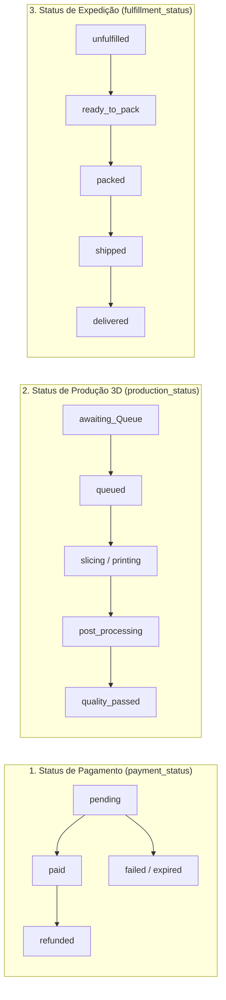

# Arquitetura da Plataforma RBS Criação (`rbscriacao-v3`)

## 1. Visão Geral e Decisões Arquiteturais

A plataforma **RBS Criação (`rbscriacao-v3`)** foi reconstruída integralmente como um **Monólito Modular Full-Stack em TypeScript** utilizando **Next.js 16 (App Router) + React 19 + Tailwind CSS 4 + PostgreSQL Transacional ACID**.

### Por que esta arquitetura substitui WordPress/WooCommerce e o protótipo Firebase anterior?
1. **Zero Dependência de Plugins Genéricos**: Regras críticas de manufatura aditiva (conversão automática de filamento de `kg` para `g`, baixa de gramas no Kanban, precificação com margem sobre o preço final, separação entre prazo de fabricação 3D e transporte, e carrinho com seleção parcial real) fazem parte do núcleo de domínio em TypeScript.
2. **Transações ACID e Bloqueio de Concorrência**: Ao contrário de coleções NoSQL soltas ou metadados `wp_postmeta`, todas as operações financeiras, reservas de estoque e compras parciais rodam em transações SQL atômicas (`BEGIN ... COMMIT / ROLLBACK`), impedindo venda duplicada da última unidade em estoque.
3. **Portabilidade Total de Banco PostgreSQL**: O adaptador `src/db/index.ts` conecta-se de forma transparente a um cluster PostgreSQL externo via `DATABASE_URL` (Supabase, Neon, RDS ou PostgreSQL dedicado) ou executa localmente sobre o motor PostgreSQL embarcado persistente (`@electric-sql/pglite` em `.pgdata/rbs-v3-pg`), garantindo paridade entre desenvolvimento, testes automatizados e produção.

---

## 2. Três Máquinas de Estados Desacopladas por Pedido

Na fabricação por impressão 3D, pagamento, chão de fábrica e logística não caminham no mesmo ritmo. Por isso, a tabela `orders` separa explicitamente três máquinas de estado independentes:

---

## 3. Regime de Competência (DRE) vs. Regime de Caixa (Sem Dupla Contagem de Filamento)

Um erro clássico em pequenos e-commerces de manufatura é contabilizar o filamento 3 vezes: na compra do rolo, no consumo da máquina e no custo do pedido. Na RBS Criação (`src/lib/operations.ts`), o razão financeiro (`financial_entries`) separa rigorosamente a natureza contábil (`accounting_class`):

| Evento Operacional | Classificação (`accounting_class`) | Impacta Fluxo de Caixa? | Impacta DRE por Competência? | Momento do Reconhecimento |
|---|---|---|---|---|
| **Compra de Rolo de Filamento (1 kg = 1.000 g)** | `inventory_asset_purchase` | **Sim** (Saída de Caixa no pagamento) | **Não** (É troca de caixa por ativo em estoque) | Na liquidação do título ao fornecedor |
| **Consumo de Gramas no Kanban 3D (`quality_passed`)** | `cogs_supply_consumed` | **Não** (O rolo já foi pago) | **Sim** (Deduz CPV / CMV pela gramatura real) | Na conclusão da impressão 3D |
| **Falha de Impressão / Perda de Material** | `waste_loss_expense` | **Não** | **Sim** (Despesa operacional de refugo) | No registro da falha no Kanban |
| **Venda de Produto 3D** | `gross_revenue` | **Sim** (No recebimento líquido) | **Sim** (Pela data de competência do pedido) | Na aprovação do pedido |
| **Taxa MDR do Gateway (Mercado Pago)** | `gateway_fee_deduction` | **Sim** (Abatido do repasse) | **Sim** (Dedução direta da receita bruta) | Na conciliação do pagamento |

---

## 4. Modelo de Dados Relacional (28 Tabelas Versionadas)

O esquema completo encontra-se em [`src/db/migrations/001_initial_schema.sql`](file:///C:/Users/RodrigoC/Documents/IA IDEIAS/rbscriacao-v3/src/db/migrations/001_initial_schema.sql):

1. **Identidade, RBAC, Sessão e Auditoria**: `users`, `customer_addresses`, `audit_logs`, `async_jobs`.
2. **Catálogo 3D, Variações e Mídia**: `categories`, `collections`, `products`, `product_variations`, `product_media`.
3. **Estoque Multi-Local, Insumos (`kg -> g`) e Consignação**: `inventory_locations`, `supplies`, `inventory_balances`, `stock_reservations`, `inventory_movements`, `partners`, `consignment_batches`.
4. **Carrinho Seletivo, Favoritos e Alertas LGPD**: `carts`, `cart_items`, `wishlists`, `interest_alerts`.
5. **Pedidos, Orçamentos `.STL`/`.STEP` e Kanban de Produção 3D**: `orders`, `order_items`, `production_jobs`, `print_failures`, `custom_quotes`.
6. **Financeiro, Conciliação de Taxas e Precificador**: `financial_accounts`, `financial_entries`, `fee_reconciliations`, `pricing_presets`, `pricing_simulations`.
7. **Marketing, Banners Responsivos, Instagram `@rbscriacao` e Inteligência Comercial**: `promotions`, `banners`, `social_posts`, `commercial_events`.
